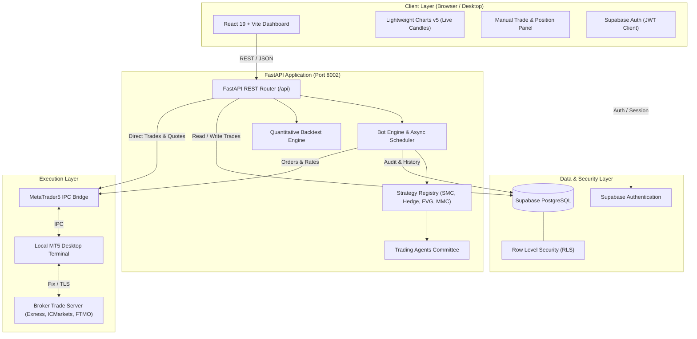

# ⚡ Trade-AI

> **Institutional-Grade Autonomous Algorithmic Trading Engine, Real-Time Market Terminal & Multi-Strategy Portfolio Manager.**

[](https://python.org)
[](https://fastapi.tiangolo.com)
[](https://react.dev)
[](https://vitejs.dev)
[](https://www.metatrader5.com)
[](https://supabase.com)
[](https://www.tradingview.com/lightweight-charts/)

---

## 📌 Executive Summary

**Trade-AI** is a modern, high-performance algorithmic trading platform engineered for multi-asset automated execution, quantitative backtesting, and institutional manual analysis. 

Featuring an ultra-responsive **React 19** frontend and a concurrent asynchronous **Python FastAPI** backend, Trade-AI interfaces directly with local **MetaTrader 5 (MT5)** terminals. This architecture eliminates third-party cloud API latency and custody risks, routing orders directly to your broker of choice with sub-millisecond execution speeds.

---

## 🌟 Key Features

### 1. 🤖 Autonomous Multi-Agent & Strategy Engine
* **Concurrent Bot Engine**: Asynchronous scheduler capable of running multiple strategy bots in parallel across disparate currency pairs and timeframes.
* **Intelligent Auto-Resume**: Recovers active bot configurations and state from PostgreSQL on backend startup.
* **Pre-Built Strategy Catalog**:
  * **Signal Strength Hedge**: Quantitative multi-tier grid with algorithmic recovery and opposing leg hedging.
  * **Scalp Pyramid**: Dynamic trend continuation scaling with micro-trailing stops.
  * **Fair Value Gap (FVG) Scalper**: ICT-inspired liquidity sweep, order block mitigation, and displacement entry.
  * **Smart Money Concepts (SMC)**: Break of Structure (BOS), Change of Character (CHOCH), and premium/discount equilibrium pricing.
  * **MMC Mirror**: Precision mirror entry with volatility filters and adaptive session Kill Zones (London & New York).
  * **Nyao Scalper**: Micro-lot high-frequency scalp automation with tight pip targets.
  * **Multi-Agent Committee**: Multi-perspective LLM reasoning framework evaluating multi-timeframe trend alignment, volatility indexes, and risk parameters prior to trade confirmation.

### 2. 📊 Interactive Market & Manual Trading Terminal
* **High-Frequency Candlestick Charts**: Integrated **Lightweight Charts v5** with smooth 60fps pan/zoom and multi-timeframe switching (`M1`, `M5`, `M15`, `H1`, `H4`, `D1`).
* **Live Order Execution**: Instant market **BUY** and **SELL** routing with dynamic broker filling-mode detection (`IOC`, `FOK`, `RETURN`).
* **Interactive Risk Controls**: Rapid lot size steppers, quick lot chips (`0.01` to `1.00`), pip-offset Stop Loss/Take Profit calculators, and custom trade rationale tagging for performance journaling.
* **Real-Time Position Management**: Inspect open floating tickets, monitor live unrealized P&L, and execute single-click position closures directly from the chart modal.

### 3. 🔬 Rigorous Quantitative Backtesting Suite
* **Historical Simulation Engine**: Backtest any strategy across variable lookbacks (30, 60, 90, 180 days) using historical tick and bar data copied directly from broker history.
* **Multi-Symbol Benchmarking**: Batch runner (`multi_backtest.py`) capable of stress-testing multiple pairs across varying timeframes simultaneously.
* **Detailed Performance Metrics**: Computes Win Rate, Profit Factor, Max Drawdown (percentage and monetary), Total Trades, Sharpe Ratio approximation, and detailed CSV trade journals.

### 4. 🛡️ Enterprise Security & Privacy
* **Zero Third-Party Cloud Custody**: All broker orders communicate directly between the Python engine and the local MT5 desktop terminal via Inter-Process Communication (IPC).
* **Row-Level Security (RLS)**: Fine-grained PostgreSQL policies ensure every user only accesses their own accounts, trade history, and bot settings.
* **Hardened Secrets Management**: Strict credential hygiene keeping environment keys, JWT tokens, and broker access tokens out of version control.

---

## 🏗️ System Architecture



---

## 📂 Project Structure

```
Trade-AI/
├── .env.example                     # Root frontend environment template
├── .gitignore                       # Production gitignore (security & artifact filter)
├── index.html                       # Single-page application root HTML
├── package.json                     # Frontend dependencies & build scripts
├── vite.config.js                   # Vite configuration with backend proxy
├── capacitor.config.json            # Mobile wrapper configuration (Android/iOS)
├── TradeAI_Pro_Project_Plan.md      # Architectural design & roadmap specifications
│
├── src/                             # React 19 Client Codebase
│   ├── api.js                       # Axios/Fetch wrapper with JWT injection
│   ├── App.jsx                      # Route definitions & protected layouts
│   ├── main.jsx                     # React DOM hydration
│   ├── supabase.js                  # Supabase client initializer
│   ├── index.css                    # Global themes & responsive styles
│   ├── components/
│   │   ├── ChartModal.jsx           # TradingView candlestick chart & manual trade desk
│   │   ├── AIAgentsModal.jsx        # Multi-agent AI trading committee interface
│   │   ├── BotCard.jsx              # Automated bot status, metrics & control card
│   │   ├── MMCDashboard.jsx         # Market Maker Confluence live tracker
│   │   ├── Navbar.jsx               # Navigation bar with MT5 Copilot modal
│   │   ├── Sidebar.jsx              # Primary application sidebar navigation
│   │   ├── StrategyConfigModal.jsx  # Bot parameter tuning modal
│   │   └── Toast.jsx                # Toast notification system
│   ├── pages/
│   │   ├── Accounts.jsx             # Broker account credentials & connection manager
│   │   ├── Admin.jsx                # System administration & telemetry
│   │   ├── Analytics.jsx            # Performance analytics, equity curves & metrics
│   │   ├── Bot.jsx                  # AI Bots configuration & launchpad
│   │   ├── Dashboard.jsx            # Main operational trading dashboard
│   │   ├── Login.jsx                # Authentication & registration page
│   │   ├── Markets.jsx              # Live market screener & watchlist
│   │   ├── Profile.jsx              # User account & subscription settings
│   │   └── Settings.jsx             # Risk parameters & API provider settings
│   └── services/
│       └── marketData.js            # Market data parsing & calculation helpers
│
├── backend/                         # Python FastAPI Backend
│   ├── .env.example                 # Backend environment variable template
│   ├── main.py                      # FastAPI application entrypoint & startup hooks
│   ├── requirements.txt             # Primary Python dependencies
│   ├── backtest.py                  # Standalone backtesting CLI engine
│   ├── multi_backtest.py            # Multi-pair/timeframe batch backtesting
│   ├── init_tables.sql              # Supabase table schema creation script
│   ├── app/
│   │   ├── config.py                # Pydantic BaseSettings environment loader
│   │   ├── database.py              # Supabase client & service role connector
│   │   ├── middleware.py            # JWT authentication & admin authorization
│   │   ├── routers/
│   │   │   ├── accounts.py          # Account registration & broker sync routes
│   │   │   ├── ai_agents.py         # AI committee decision endpoints
│   │   │   ├── analytics.py         # Trade analytics & metrics calculation
│   │   │   ├── bots.py              # Bot lifecycle management (start/stop/config)
│   │   │   ├── health.py            # System health & MT5 quote streaming
│   │   │   ├── payments.py          # Subscription & billing webhooks
│   │   │   └── trades.py            # Manual trade execution, close & position endpoints
│   │   ├── schemas/                 # Pydantic request & response validation schemas
│   │   └── services/
│   │       ├── bot_engine.py        # Central bot scheduler & loop manager
│   │       ├── metaapi_service.py   # MetaTrader 5 terminal connector & symbol mapper
│   │       ├── scalp_scheduler.py   # Specialized scalping scheduler
│   │       └── strategies/          # Algorithmic strategy implementations
│   └── backtesting/                 # Strategy-specific historical backtest scripts
│
└── supabase/                        # Database Migrations
    └── migrations/
        ├── 001_schema.sql           # Base tables (users, accounts, trades, bots)
        ├── 002_add_strategies.sql   # Extended strategy schemas & stats
        ├── 003_fix_accounts.sql     # Account schema hardening
        ├── 004_add_ss_hedge.sql     # Signal strength hedge configuration
        └── 005_add_nyao_scalper.sql # Nyao scalper configuration
```

---

## ⚡ Quickstart Guide

### Prerequisites

| Software | Version | Purpose |
| :--- | :--- | :--- |
| **Node.js** | `>= 18.x` | Frontend runtime environment |
| **Python** | `>= 3.10` (Windows recommended) | Backend API & MT5 library runtime |
| **MetaTrader 5** | Build 4000+ | Local desktop trading terminal |
| **Supabase** | Cloud or Self-hosted | PostgreSQL database & Auth provider |

---

### Step 1: Clone the Repository

```bash
git clone https://github.com/ihsanaq0-ctrl/Trade-AI.git
cd Trade-AI
```

---

### Step 2: Configure Environment Variables

#### Frontend Environment
Create `.env` in the root directory:
```bash
cp .env.example .env
```
Populate `.env`:
```env
# Leave empty to utilize Vite's transparent proxy to http://localhost:8002
VITE_API_BASE_URL=

# Supabase Credentials (obtain from Supabase Dashboard -> Project Settings -> API)
VITE_SUPABASE_URL=https://your-project-id.supabase.co
VITE_SUPABASE_ANON_KEY=your-supabase-anon-key
```

#### Backend Environment
Create `backend/.env`:
```bash
cd backend
cp .env.example .env
```
Populate `backend/.env`:
```env
SUPABASE_URL=https://your-project-id.supabase.co
SUPABASE_KEY=your-supabase-anon-key
SUPABASE_SERVICE_KEY=your-supabase-service-role-key
SUPABASE_JWT_SECRET=your-supabase-jwt-secret
CORS_ORIGINS=http://localhost:5173
LOG_LEVEL=INFO
```

---

### Step 3: Database Migration

Execute the migration scripts in your **Supabase SQL Editor** in order:
1. `backend/init_tables.sql`
2. `supabase/migrations/001_schema.sql`
3. `supabase/migrations/002_add_strategies.sql`
4. `supabase/migrations/003_fix_accounts_schema.sql`
5. `supabase/migrations/004_add_signal_strength_hedge.sql`
6. `supabase/migrations/005_add_nyao_scalper.sql`

---

### Step 4: Configure MetaTrader 5

1. Open your **MetaTrader 5 Desktop Terminal**.
2. Log into your broker trading account (Demo or Live).
3. Navigate to **Tools → Options → Expert Advisors**:
   * ✅ Check **"Allow automated trading"**
   * ✅ Check **"Allow WebRequest for listed URL"**
4. Open the **Market Watch** window (`Ctrl+M`) and add your desired trading instruments (e.g. `EURUSD`, `GBPUSD`, `USDJPY`, `XAUUSD`, `BTCUSD`).

---

### Step 5: Start the Backend API

Open **Terminal 1**:
```bash
cd backend

# Create virtual environment (optional but recommended)
python -m venv .venv
.venv\Scripts\activate

# Install dependencies
pip install -r requirements.txt

# Start FastAPI server on port 8002 with hot reload
uvicorn main:app --host 0.0.0.0 --port 8002 --reload
```
API Documentation will be live at:
* Swagger UI: **http://127.0.0.1:8002/docs**
* ReDoc: **http://127.0.0.1:8002/redoc**

---

### Step 6: Start the Frontend Application

Open **Terminal 2**:
```bash
# In the project root (Trade-AI/)
npm install

# Start Vite development server
npm run dev
```
Open **http://localhost:5173** in your browser.

---

## 📈 Quantitative Backtesting Guide

Trade-AI includes an institutional-grade backtesting engine capable of analyzing millions of historical data points directly from broker feeds.

```bash
cd backend

# Single-symbol, single-timeframe historical test
python backtest.py --symbol EURUSD --timeframe H1 --days 90

# Test Gold on M5 with custom spread
python backtest.py --symbol XAUUSD --timeframe M5 --days 30

# Multi-symbol comparison test
python multi_backtest.py --symbols EURUSD,GBPUSD,USDJPY,XAUUSD --timeframes H1,H4 --days 60 --output results.csv
```

---

## 📡 API Reference Overview

| Method | Endpoint | Description |
| :--- | :--- | :--- |
| `GET` | `/api/health` | Service health status & connectivity check |
| `GET` | `/api/markets/prices` | Real-time bid/ask/spread tick streaming from MT5 |
| `GET` | `/api/markets/candles` | Fetch OHLCV candlestick historical arrays |
| `GET` | `/api/markets/active-account`| Active logged-in MT5 account balance & equity |
| `POST`| `/api/trades/open` | **Execute manual market BUY/SELL order with SL/TP** |
| `GET` | `/api/trades/positions` | **Query live floating open positions from MT5 terminal** |
| `POST`| `/api/trades/close` | **Close open position by MT5 ticket number** |
| `POST`| `/api/trades/modify-sl` | Update dynamic Stop Loss and Take Profit |
| `POST`| `/api/trades/partial-close`| Partially scale out of an active position |
| `GET` | `/api/bots` | List all configured strategy bots |
| `POST`| `/api/bots/{id}/start` | Initialize autonomous strategy loop |
| `POST`| `/api/bots/{id}/stop` | Safely halt autonomous strategy loop |
| `GET` | `/api/analytics/metrics` | Retrieve calculated win rates, profit factor & drawdown |

---

## 🔒 Security Best Practices

1. **Keep Secrets Private**: Never commit `.env` or production credentials. Ensure `.env` is listed in `.gitignore`.
2. **Use Demo Accounts First**: Always validate bot logic and parameter settings on a demo account before risking real capital.
3. **Set Proper Max Risk**: Configure strict daily loss thresholds in `Settings` to protect your equity during extreme volatility events.
4. **Local Isolation**: Trade-AI is built to run on your private workstation or a dedicated Windows VPS with local MT5 access. Do not expose unauthenticated ports to the public internet.

---

## ⚖️ Disclaimer

*Trading foreign exchange, commodities, cryptocurrencies, and financial derivatives carries a substantial level of risk and may not be suitable for all investors. The high degree of leverage can work against you as well as for you. Before deciding to trade, you should carefully consider your investment objectives, level of experience, and risk appetite. The developers and contributors of Trade-AI accept no liability for financial losses incurred as a result of using this software.*

---

## 📄 License

This project is licensed under the terms specified in the repository. Developed with precision by [ihsanaq0-ctrl](https://github.com/ihsanaq0-ctrl).
